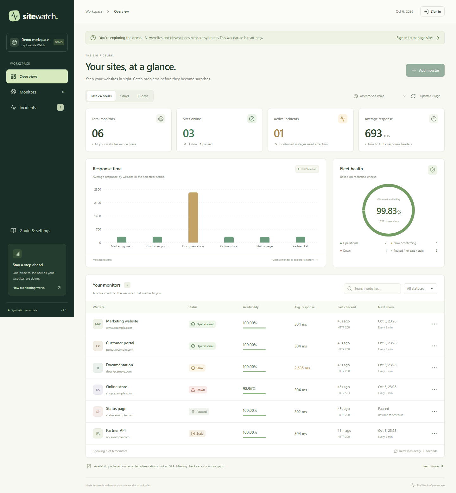

# Site Watch

**Acompanhe todos os seus domínios em um só lugar.** Um monitor HTTP para uso próprio, pensado para freelancers, agências e quem mantém vários sites.

[English](README.md) · [Arquitetura](docs/ARCHITECTURE.md) · [API](docs/API.md) · [Implantação](docs/DEPLOYMENT.md) · [Como contribuir](CONTRIBUTING.md)



O Site Watch ajuda a descobrir qual domínio precisa de atenção, se a falha está no DNS, TLS, conexão ou resposta HTTP, quando o problema foi confirmado e se as respostas ficaram lentas. As verificações acontecem no servidor e continuam com o navegador fechado.

O código é público e usa a licença MIT. Cada instalação atende **um administrador e até 20 monitores**. Toda a interface está em inglês para atender um público mais amplo. A demonstração pública é somente para leitura e identifica seus dados como sintéticos; o painel real e os endereços de e-mail exigem login.

## O que você pode fazer

- Cadastrar, editar, pausar, retomar e excluir monitores de URLs públicas HTTP/HTTPS.
- Escolher verificações a cada 1, 5 ou 15 minutos, timeout total e limite de lentidão.
- Buscar domínios, filtrar estados e acompanhar respostas, disponibilidade observada, incidentes e atualização do worker.
- Abrir os detalhes com gráficos, verificações recentes, lacunas e histórico de falhas/recuperações em 24 horas, 7 dias ou 30 dias.
- Informar um e-mail opcional por monitor, para receber avisos de falha confirmada e recuperação.
- Manter histórico no PostgreSQL, com verificações feitas por um worker separado.
- Usar autenticação, sessões com expiração, proteção contra CSRF, limitação de login e proteção contra SSRF.
- Ver os horários no fuso selecionado, com `America/Sao_Paulo` como padrão.

## Instalação passo a passo

Você precisa de **Node.js 22 LTS, versão 22.13 ou superior dessa linha**, npm 11.6+ e Docker Desktop ou Docker Engine com Compose v2. A execução local não exige um serviço pago.

```bash
git clone https://github.com/Lucgusta/site-watch.git
cd site-watch
npm ci
npm run setup
docker compose up --build
```

1. `npm ci` instala as versões registradas no lockfile.
2. `npm run setup` pede usuário e senha do administrador, salva o hash da senha e gera segredos aleatórios no `.env` privado. Não existe senha padrão publicada.
3. `docker compose up --build` inicia banco, migrations, API/interface e worker.
4. Abra **http://localhost:3000**. Você pode explorar a demonstração ou entrar com suas credenciais.
5. Clique em **Add monitor**, informe uma URL pública como `https://example.com` e aguarde a primeira coleta.

O setup não sobrescreve um `.env` existente. Para gerar uma senha aleatória sem interação, use `npm run setup -- --generate`; as credenciais ficam apenas em `.runtime/initial-admin.txt`, ignorado pelo Git. Guarde a senha com segurança e remova esse arquivo temporário.

Os dados ficam no volume Docker `site_watch_data`. Parar e iniciar os serviços preserva os dados. Remover o volume apaga o histórico. Se uma porta estiver ocupada, ajuste `POSTGRES_PORT` ou `PORT` no `.env`; mantenha `DATABASE_URL` alinhado com a porta do banco local e ajuste `APP_ORIGIN` quando alterar a porta do site. Dentro do Docker, o PostgreSQL continua usando 5432.

## Notificações por e-mail, se você quiser

O campo **Notification email** é opcional. Deixe em branco para acompanhar apenas os avisos no painel.

Para enviar e-mails, configure seu provedor SMTP no `.env` privado:

```dotenv
SMTP_HOST=smtp.example.com
SMTP_PORT=587
SMTP_SECURE=false
SMTP_USER=seu-usuario-smtp
SMTP_PASSWORD=sua-senha-smtp
SMTP_FROM=monitor@example.com
```

A porta 587 usa STARTTLS. Para TLS desde o início da conexão, use porta 465 e `SMTP_SECURE=true`. Depois de alterar as variáveis, recrie API e worker: `docker compose up -d --force-recreate api worker`.

No cadastro ou na edição do monitor, preencha **Notification email** com o destinatário. A **segunda falha consecutiva** confirma o incidente e agenda o aviso; uma resposta HTTP bem-sucedida registra a recuperação e agenda outro aviso. Novas falhas do mesmo incidente não geram avisos repetidos. A fila é persistente e o worker tenta novamente quando o envio falha. Veja [as garantias de entrega](docs/DEPLOYMENT.md#email).

Sem SMTP configurado, o painel informa essa condição. Ter um destinatário cadastrado, por si só, não configura o serviço de envio.

## Como interpretar os resultados

| Informação | Significado |
| --- | --- |
| Response time | Tempo do início da tentativa até receber os cabeçalhos HTTP finais, incluindo DNS, conexão, TLS e redirecionamentos. O corpo da página é descartado. |
| Observed availability | Verificações HTTP bem-sucedidas / verificações do site concluídas × 100. O painel informa o número de amostras; erros internos e períodos sem coleta são excluídos. |
| Average | Média aritmética dos tempos das respostas HTTP bem-sucedidas no período. |
| p95 | Método de posição mais próxima: ordenar os tempos bem-sucedidos e escolher o índice `ceil(0,95 × n) - 1`. Observe também o número de amostras. |
| Slow | Resposta HTTP bem-sucedida acima do limite de lentidão; continua contando como sucesso. |
| Stale data | Ausência de coleta útil por mais de dois intervalos mais o timeout, ou erro interno de coleta. Isso não comprova que o site caiu. |

A primeira falha aparece como **Failure pending**. A segunda falha consecutiva confirma um incidente. O próximo sucesso registra a recuperação observada. Os horários são de observação; não é possível determinar exatamente quando o site caiu ou voltou entre duas verificações.

HTTP bem-sucedido significa status final de 200 a 299. Isso **não valida uma compra, login, JavaScript ou todos os recursos da página**. A disponibilidade observada é uma proporção de amostras, não um SLA nem um percentual exato de tempo online. Sem amostras, o painel mostra ausência de dados. Os gráficos preservam lacunas de coleta. Verificações brutas são mantidas por 30 dias; incidentes permanecem após essa limpeza.

## Um roteiro para investigar problemas

1. Abra os detalhes do domínio que precisa de atenção.
2. Confira quando a última coleta aconteceu. **Stale data** pede verificar o worker e o banco antes de concluir que o site caiu.
3. Veja a categoria do erro: **DNS**, **TLS**, **CONNECTION**, **TIMEOUT** ou **HTTP_STATUS**.
4. Compare o histórico de resposta e as primeiras falhas com mudanças de DNS, certificado ou implantação do site.
5. Acompanhe a recuperação no histórico. Um check manual usa o mesmo pipeline seguro e fica sujeito ao limite de frequência.

## Desenvolvimento e validação

```bash
npm ci
npm run setup                  # só na primeira vez
docker compose up -d db
npm run db:generate
npm run db:migrate
npm run dev
```

No desenvolvimento, a interface abre em http://localhost:5173 e encaminha `/api` para a porta 3000. Configure `APP_ORIGIN=http://localhost:5173` no `.env` e reinicie a API; as operações de escrita verificam essa origem.

```bash
npm run lint
npm run typecheck
npm test
npm run build
```

O [guia de testes](docs/TESTING.md) explica os testes com PostgreSQL separado e o fluxo de navegador com Playwright. O GitHub Actions valida lint, tipos, testes, build, integração com banco e login/cadastro/detalhes/pausa.

O [registro de validação da primeira versão](docs/VALIDATION.md) informa os resultados locais e o que foi verificado sobre e-mail e implantação.

## Organização para estudar o código

```text
apps/web/            Painel React, formulários e gráficos em inglês
apps/server/src/     API Fastify, autenticação, transporte seguro, worker e e-mails
apps/server/prisma/  Modelo de dados e migrations PostgreSQL
scripts/             Setup privado, testes e publicação protegida no GitHub
docs/                Arquitetura, API, testes, implantação e capturas reais
.github/             CI e modelos para contribuições
```

Leia [a arquitetura](docs/ARCHITECTURE.md) para acompanhar uma verificação do agendamento até o incidente e o e-mail. Os dados sintéticos da demonstração são gerados separadamente e nunca são inseridos nas métricas reais.

## Publicação e hospedagem

O repositório é público para que qualquer pessoa possa estudar, usar e contribuir. Cada pessoa pode hospedar sua própria instalação. Para disponibilizar a aplicação na internet, é necessário um servidor com PostgreSQL persistente, HTTPS e processos contínuos de API e worker. Use apenas um worker; ele executa até três verificações simultâneas e evita sobreposição por monitor.

**GitHub guarda o código. GitHub Pages sozinho não executa o backend, banco, fila SMTP ou worker.** Veja o [guia de implantação](docs/DEPLOYMENT.md). Publicar o repositório e hospedar uma aplicação online são etapas distintas; o link do código não significa que existe uma implantação pública funcionando.

## Próximas possibilidades

- Alertas por Telegram e avisos de vencimento de certificado.
- Mais administradores, equipes e limite de monitores configurável.
- Página pública de status com dados escolhidos explicitamente.
- Testes de navegador para login, compra e renderização.
- Histórico agregado além dos 30 dias de verificações brutas.

Contribuições são bem-vindas: [CONTRIBUTING.md](CONTRIBUTING.md). Reporte problemas de segurança conforme [SECURITY.md](SECURITY.md). Licença [MIT](LICENSE).
