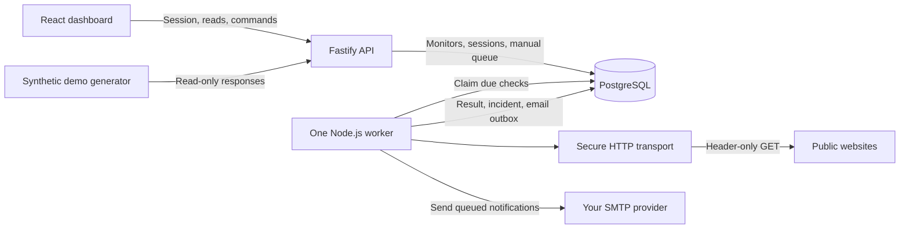
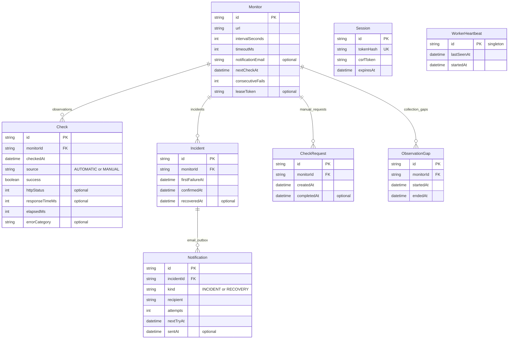

# How Site Watch works

Site Watch is a small, self-hosted system for one administrator managing up to 20 public websites. The browser displays observations; a separate worker performs the checks. Closing the browser does not stop monitoring.

[Setup](../README.md#quick-start) · [API examples](API.md) · [Deployment](DEPLOYMENT.md) · [Português](../README.pt-BR.md)

## Follow the data



The API serves the compiled React frontend in production, so the UI and `/api` share one origin. During development, Vite proxies `/api` to Fastify. PostgreSQL holds schedules and history; no schedule depends on a browser timer or an API process staying in memory. Docker Compose runs the database, API/frontend, and worker as separate services.

The public demo is generated by [demo.ts](../apps/server/src/demo.ts). It does not resolve the example domains, insert checks, or send messages. The real dashboard requires an administrator session, and the API rejects demo mutations even if someone manually constructs a request.

## One check, step by step

1. **Store the configuration.** The API validates the monitor name, public HTTP/HTTPS URL, interval, timeout, slow threshold, and optional notification email. It persists `nextCheckAt`. Monitor creation uses a transaction and an advisory lock so concurrent requests cannot exceed the 20-monitor cap.
2. **Claim work in PostgreSQL.** The worker selects due, unpaused monitors or pending manual requests. `FOR UPDATE SKIP LOCKED` and a lease token prevent the same monitor from being claimed twice. A lease lasts the configured timeout plus 60 seconds.
3. **Check the destination safely.** The transport resolves both A and AAAA records, validates every returned address, and pins a validated IP to the actual connection. The hostname remains available for the HTTP host header, TLS SNI, and certificate validation.
4. **Receive the final headers.** A GET follows at most five redirects. Every destination goes through the same checks. One deadline covers DNS, connection, TLS, and every redirect. The response body is destroyed without being downloaded or buffered as a page.
5. **Commit the observation.** A database transaction writes the check, changes the failure counter, opens or closes an incident when necessary, queues any email, releases the lease, and sets the next due time. A late result with an obsolete lease token is discarded.
6. **Refresh the dashboard.** The browser reads the stored data. Its 30-second refresh updates the display; it does not trigger the monitoring schedule.

The worker runs at most three check pipelines concurrently and waits for the current batch before claiming another. Automatic and manual checks share the transport, persistence rules, concurrency limit, and incident logic. A manual request is a durable queue entry, not an HTTP request executed inside the API.

After an attempt completes, the next scheduled attempt is due one configured interval later. A manual observation also updates that schedule. The permitted intervals are 60, 300, and 900 seconds; the default is 300. Timeout accepts 1,000–30,000 milliseconds, default 10,000. The slow threshold accepts 100–30,000 milliseconds, default 2,000.

## Persistent records



[schema.prisma](../apps/server/prisma/schema.prisma) defines the Prisma models. The [initial migration](../apps/server/prisma/migrations/20261006000000_initial/migration.sql) adds database constraints and indexes, including a partial unique index allowing only one open incident per monitor. Email has a unique `(incidentId, kind)` key, so repeated failed checks do not enqueue repeated incident alerts.

Check and incident indexes include the monitor and observation date. Timestamps are stored and exchanged in UTC. The browser initially displays `America/Sao_Paulo`; choosing another timezone changes presentation, not schedules or persisted times.

Deleting a monitor cascades to its checks, incidents, queued manual requests, gaps, and incident notifications. The UI asks for confirmation. Raw-check retention does not perform this cascade: it removes old checks while preserving the monitor and incident history.

## Failure confirmation and recovery

Each completed website observation either succeeds with a final HTTP status from 200 through 299, or fails. A redirect that is not followed to a successful final response is not success. A successful response above the slow threshold remains a successful check.

Example with a five-minute interval; the times below are observation times:

| Observation | Outcome | State and stored change |
| --- | --- | --- |
| 12:00 | HTTP 503 | `PENDING`: remember the first failure; no incident yet. |
| 12:05 | Connection failure | `DOWN`: create one incident, first failure 12:00 and confirmation 12:05. |
| 12:10 | HTTP 503 | `DOWN`: keep the same incident open. |
| 12:15 | HTTP 200 in 2,600 ms | Record recovery at 12:15; show `SLOW` if the threshold is 2,000 ms. |

The timestamps say when failure and recovery were observed. They do not establish the exact second the website went down or recovered between observations. If the first failed observation is followed by success, the failure counter resets without opening an incident.

`INTERNAL` errors describe the monitor's own failure to collect a usable observation. They are recorded, create an observation gap, and do not advance or reset the website failure counter. Thus two failed website observations separated by an internal collection error can still confirm an incident; the missing observation makes the timing uncertain.

States use this precedence:

| State | Meaning |
| --- | --- |
| `PAUSED` | Explicitly paused, regardless of old results. |
| `STALE` | More than two intervals plus the timeout since the last usable observation, or the newest attempt is an internal collection error. |
| `NO_DATA` | No observation yet, while still inside the initial freshness window. |
| `DOWN` | At least two consecutive failed website observations. |
| `PENDING` | One failed website observation awaiting confirmation. |
| `SLOW` | Successful final HTTP response above the configured threshold. |
| `UP` | Successful final HTTP response within the threshold. |

A new monitor with no collection eventually becomes stale using its creation time. A worker outage can make an old `UP`, `PENDING`, or `DOWN` display stale; it does not create a new website incident by itself. The independently reported worker heartbeat is written every 10 seconds and considered stale after 45 seconds without an update.

## Measurements and charts

**Response time** is measured with a monotonic clock from the beginning of the attempt to receipt of the final response headers. It includes DNS, TCP connection, TLS, and redirects, and is rounded to milliseconds. HTTP 503 can therefore have a measured response time. A DNS failure or timeout has `responseTimeMs: null` and a separate `elapsedMs`; it is never converted into a zero-millisecond response.

**Observed availability** is:

```text
successful completed website checks / completed website checks × 100
```

For example, 90 successful observations and 10 failed observations produce 90% from 100 samples. Internal monitor errors and periods without collection contribute no sample to either side. Automatic and manual observations both count. This is a ratio of observations from this installation, not an SLA or an exact fraction of wall-clock time online.

**Average response** is the rounded arithmetic mean of successful HTTP response times. **p95** uses the nearest-rank method: sort successful response times and take item `ceil(0.95 × n)`, using one-based numbering. PostgreSQL uses `percentile_disc(0.95)` for the same discrete percentile. For sorted values `[100, 200, 300, 400, 500]`, the mean is 300 ms and p95 is 500 ms. One successful sample produces that sample's value; interpret it alongside the sample count. Without successful response samples, average and p95 are `null`. With no completed website samples, availability is also `null`.

Metrics use all retained checks in the selected rolling 24-hour, 7-day, or 30-day window. They do not use only the recent rows displayed in the detail table. The response chart covers the entire window with average successful response times per bucket:

| Period | Chart bucket |
| --- | --- |
| 24 hours | 5 minutes |
| 7 days | 30 minutes |
| 30 days | 2 hours |

Each bucket also reports its number of website observations. Empty buckets and buckets with no successful response have a `null` response. Recorded collection gaps are returned separately, and the UI leaves null segments disconnected. A bucket containing both success and failure shows the mean of its successful responses; inspect recent checks or the paginated checks endpoint for individual results.

An observation gap is recorded when an internal failure occurs, or when collection resumes after a delay exceeding the freshness threshold. A stopped worker first appears through stale data and its missing heartbeat; the historical gap is recorded on the next usable observation. Gap length is not added to confirmed downtime.

## Restarts, pauses, and retention

The supported deployment has **one worker**. A PostgreSQL advisory lock held on a dedicated connection prevents a second worker from starting. Losing that connection stops the worker's loop. Expanding to multiple workers needs a different global-concurrency design; changing the replica count is insufficient.

On startup, the worker clears abandoned leases only after obtaining the singleton lock. It moves overdue schedules into a small randomized 1–15-second window. It does not manufacture missed observations or replay every interval missed while offline. Configuration, results, incidents, manual requests, and queued email remain in PostgreSQL.

Pausing a monitor prevents new claims and completes pending manual requests without executing them. A result that finishes after the monitor was paused is discarded. Resuming schedules it shortly afterward. Changing the URL is rejected while a check is in flight or an incident remains open; otherwise it resets the current failure streak and latest-target state. Earlier checks stay in the monitor's historical metrics, so create a new monitor when you need a separate history for a different website.

Every minute, incremental cleanup deletes at most 5,000 checks older than 30 days. It also removes expired sessions, completed manual requests older than one day, and old closed observation gaps. Incident and notification history are preserved until their monitor is deleted. A large backlog may take several cleanup cycles.

## Administrator access

The single administrator's username and scrypt password hash come from environment configuration, with no published default password. [auth.ts](../apps/server/src/auth.ts) uses a random salt and scrypt with `N=131072`, `r=8`, and `p=1`.

Successful login creates a random session token in a `sitewatch_session` cookie, with `HttpOnly`, `SameSite=Strict`, a 12-hour expiration, and `Secure` in production. PostgreSQL stores an HMAC of the token, not the raw cookie. Logout removes the session, so its old cookie cannot continue accessing the real dashboard.

Every API mutation requires an `Origin` exactly matching `APP_ORIGIN`. Authenticated mutations also require the session's `X-CSRF-Token`, returned by login or the session endpoint. Login is limited to five attempts per minute per requester, and the API applies a general request limit. See [API authentication](API.md#authentication) for a complete example.

## Optional email delivery

The `notificationEmail` field can be omitted or `null`. Monitoring, incidents, and dashboard notices work without it. Set a recipient on a monitor and configure your own SMTP environment values to enable delivery.

When the second consecutive website failure opens an incident, the same database transaction creates one `INCIDENT` notification. A successful observation closing it creates one `RECOVERY` notification, using the monitor's recipient at that transition. Editing an email address does not redirect already-queued messages.

The worker sends up to 10 due messages per delivery pass, with email delivery running independently of the check cycles so a slow SMTP server does not hold up website checks. Failures use a persisted retry schedule: 1, 2, 4, and 8 minutes before the remaining attempts, with a maximum of five total delivery attempts. After the fifth failure, the row is marked abandoned. SMTP failures never change website health or reopen an incident. Without SMTP configuration, queued messages wait until a sender is configured.

Delivery is **at least once**: if SMTP accepts a message and the worker crashes before saving `sentAt`, a retry can send a duplicate. The database prevents duplicate outbox rows for a transition; it cannot make the external SMTP delivery transactional. Recovery does not guarantee that an earlier queued incident message already arrived. `/api/notifications` reports delivery failures for the authenticated administrator.

Port 587 uses required STARTTLS when `SMTP_SECURE=false`; port 465 normally uses TLS from the beginning with `SMTP_SECURE=true`. The SMTP provider, credentials, and actual mailbox acceptance remain installation-specific. See [email deployment](DEPLOYMENT.md#email).

## Outbound request safety

[transport.ts](../apps/server/src/transport.ts) accepts only HTTP/HTTPS on ports 80/443, without embedded credentials. It rejects local and special-use hostnames; private, loopback, link-local, reserved, multicast, and cloud platform addresses; mapped IPv6; and IPv6 transition/tunnel ranges. WHATWG URL parsing normalizes encoded IPv4 before the IP policy runs. `ipaddr.js` handles address parsing and range classification.

DNS resolution validates all A/AAAA answers before opening a connection, including answers that will not be selected. A custom socket lookup returns only the validated pinned address; redirects resolve and validate again. Connections retain hostname/SNI and standard certificate validation, use no pooled socket from a previous attempt, and cancel pending DNS or requests at the total deadline. Tests inject controlled DNS, request I/O, and clocks; production has no generic switch disabling these checks.

Production hosts should additionally restrict outbound traffic to approved DNS and public HTTP/HTTPS destinations, excluding private and platform networks. The application policy and the host firewall serve different layers; [deployment](DEPLOYMENT.md) describes the operating requirements. HTTP success checks headers only: checkout, login, JavaScript rendering, and complete-page correctness require future browser-based checks.

## Where to read the code

| File | What to learn |
| --- | --- |
| [app.ts](../apps/server/src/app.ts) | Validated routes, authentication hooks, metrics queries, chart buckets, manual queue. |
| [domain.ts](../apps/server/src/domain.ts) | Pure state and metric rules. |
| [worker.ts](../apps/server/src/worker.ts) | Scheduling, leases, atomic incident transitions, retention, email retries. |
| [transport.ts](../apps/server/src/transport.ts) | URL/IP policy, DNS pinning, redirects, cancellation, error categories. |
| [auth.ts](../apps/server/src/auth.ts) | Password derivation, session hashing, token comparison. |
| [mailer.ts](../apps/server/src/mailer.ts) | SMTP sender and required TLS configuration. |
| [tests](TESTING.md) | Deterministic unit checks, real PostgreSQL integration, and the browser flow. |

## Resumo em português

O navegador apresenta os dados; um worker separado consulta os sites e salva resultados no PostgreSQL. Duas falhas observadas confirmam um incidente, e uma resposta bem-sucedida registra a recuperação. Falta de coleta fica visível como dados desatualizados ou lacunas, e o email é opcional. Consulte o [README em português](../README.pt-BR.md) para instalação e uso.
